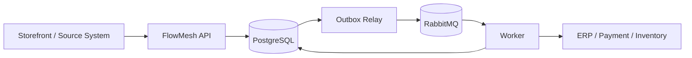
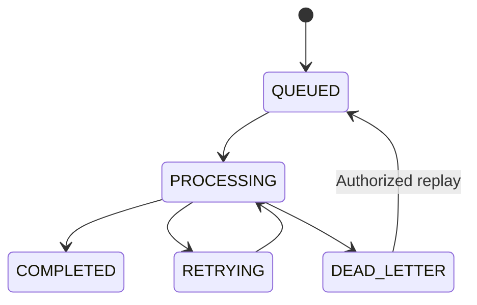

# 🌊 FlowMesh

**Reliable integrations and workflow execution for modern commerce systems.**

## The Problem

Modern commerce businesses depend on multiple systems to operate: e-commerce platforms, payment providers, inventory systems, ERPs, and shipping services.

Connecting these systems through separate point-to-point integrations creates fragile dependencies. Traffic spikes can overwhelm downstream services, temporary API failures can interrupt critical workflows, and repeated requests can result in duplicate operations.

As these integrations grow, engineering teams spend increasing amounts of time building, maintaining, monitoring, and troubleshooting them. Failed orders require manual intervention, operational overhead increases, and businesses risk losing time and revenue because their systems cannot reliably communicate.

## The Solution

**FlowMesh is a centralized integration and workflow execution layer designed to make communication between business systems reliable.**

Instead of making every application responsible for handling failures and coordinating integrations, FlowMesh receives events, stores them durably, and processes them asynchronously through controlled workers.

It is designed around key reliability mechanisms such as transactional outbox, idempotency, automatic retries, dead-letter queues, and backpressure.

## The Business Value

FlowMesh aims to help businesses:

- **Reduce engineering costs:** Spend less time building and maintaining separate point-to-point integrations.
- **Reduce operational overhead:** Minimize manual intervention when integrations fail.
- **Protect business operations:** Prevent duplicate processing and improve recovery from temporary failures.
- **Scale with confidence:** Handle traffic spikes without overwhelming downstream systems.

**The goal is simple: less time managing integrations, fewer operational failures, and more reliable business workflows.**

---

*FlowMesh is currently in early-stage development, with its initial focus on reliable event ingestion and asynchronous job processing.*


---

## Tech Stack

| Category | Technology |
|---|---|
| Runtime | Node.js |
| Language | TypeScript |
| Framework | NestJS |
| Database | PostgreSQL |
| ORM | TypeORM |
| Message Broker | RabbitMQ |
| Infrastructure | Docker & Docker Compose |
| API Documentation | OpenAPI / Swagger (planned) |
| Observability | OpenTelemetry / Prometheus (planned) |

---

## Overview

Modern commerce systems depend on multiple services, including e-commerce platforms, payment providers, inventory systems, ERPs, warehouses, and shipping providers.

Connecting these systems through individual integrations introduces operational complexity. Each integration needs its own delivery logic, retry mechanisms, error handling, and monitoring.

FlowMesh addresses this problem by introducing a centralized integration and workflow execution layer.

Instead of building and maintaining separate integration pipelines, applications can submit business events to FlowMesh, where they are persisted and processed asynchronously through controlled workers.

The system is designed around:

- **Durable persistence:** PostgreSQL acts as the source of truth for events and jobs.
- **Reliable messaging:** A transactional outbox ensures that committed work can be published to RabbitMQ.
- **Idempotent processing:** Duplicate submissions and message deliveries are handled safely.
- **Controlled execution:** Workers process jobs asynchronously with configurable concurrency.
- **Failure recovery:** Retry policies and dead-letter handling provide explicit recovery paths.
- **Multi-tenancy:** Tenant-scoped data access isolates customer operations.

The objective is to make integrations easier to operate, monitor, and scale without coupling business systems directly to one another.

---

## Architecture Overview


For a detailed explanation of the ingestion pipeline, database transactions, outbox pattern, message publishing, and worker execution, see:

[**Event Ingestion & Processing Flow**](docs/architecture/event-ingestion-flow.md)

### High-Level Architecture



### Event Processing Flow

1. **Ingest:** A source system submits an event to the FlowMesh API.
2. **Validate:** The API authenticates the tenant and validates the incoming request.
3. **Deduplicate:** An idempotency key prevents duplicate event submissions.
4. **Persist:** Events, jobs, idempotency records, and outbox records are persisted within a PostgreSQL transaction.
5. **Publish:** An outbox relay publishes committed messages to RabbitMQ.
6. **Execute:** Workers consume messages and invoke the appropriate handler or connector.
7. **Track and Recover:** Execution results are recorded. Retryable failures are rescheduled, while exhausted or permanent failures become dead-letter jobs.

For the complete technical design and failure scenarios, see [Event Ingestion & Processing Flow](docs/architecture/event-ingestion-flow.md).

---

## Getting Started

Follow these steps to prepare the local development environment.

### Prerequisites

Make sure you have the following installed:

- Node.js (compatible with the project's configured version).
- npm.
- Docker.
- Docker Compose.

### 1. Clone the Repository

```bash
git clone <repository-url>
cd flowMesh
```

### 2. Install Dependencies

```bash
npm install
```

### 3. Start Infrastructure Services

Start PostgreSQL and RabbitMQ using Docker Compose:

```bash
docker compose up -d
```

Verify that the containers are running:

```bash
docker compose ps
```

### 4. Configure Environment Variables

Create your local environment configuration using the project's environment example, if available:

```bash
cp .env.example .env
```

Configure the database and RabbitMQ connection settings to match the Docker Compose configuration.

> If `.env.example` has not been added yet, configure the variables required by the application's TypeORM and RabbitMQ configuration before starting the application.

### 5. Run the Application

Start the NestJS development server:

```bash
npm run start:dev
```

The application should now be running using your local development configuration.

> **Development note:** Database migrations, seed data, and API documentation commands will be documented here as they become available.

---

## Core Engineering Principles

### 1. PostgreSQL as the Source of Truth

PostgreSQL stores events, jobs, and their execution state.

RabbitMQ is responsible for transporting messages between the application and workers. It is not the only record that an event was accepted.

The transactional outbox pattern keeps database changes and the intent to publish messages consistent.

### 2. At-Least-Once Delivery and Idempotency

FlowMesh follows an at-least-once delivery model rather than claiming exactly-once message delivery.

Messages may be delivered more than once. Consumers must therefore handle duplicate processing safely.

Database constraints enforce idempotency-key uniqueness, while external operations should use provider-supported idempotency mechanisms whenever available.

### 3. Asynchronous Execution and Backpressure

The API should acknowledge an event once it has been durably accepted, without waiting for downstream operations to finish.

Workers execute jobs independently with controlled concurrency to prevent traffic spikes from overwhelming downstream systems.

### 4. Explicit Failure Handling

Transient failures, such as network timeouts, HTTP 429 responses, and selected 5xx responses, should follow configurable retry policies.

Exponential backoff and jitter help avoid repeated synchronized retry attempts.

Permanent failures and exhausted retries should be moved to a dead-letter state for inspection and controlled replay.

### 5. Tenant-Scoped Data Isolation

The initial architecture uses shared-schema multi-tenancy.

Every tenant-owned record and database query must be scoped by `tenant_id`.

Authorization checks and database constraints should reinforce tenant isolation.

### 6. Observability

Reliability requires visibility into the system's execution behavior.

The intended monitoring model includes:

- Job execution states.
- Processing attempts.
- Queue depth.
- Processing latency.
- Connector errors.
- Retry rates.
- Dead-letter job counts.

Every job should be diagnosable through its execution history rather than requiring manual investigation across unrelated services.

---

## MVP Scope

The initial milestone focuses on establishing a reliable event-to-job execution pipeline.

| Capability | Intended MVP Behavior |
|---|---|
| Tenant Management | Create tenants and isolate their data and credentials |
| API Authentication | Authenticate requests using tenant-scoped API keys |
| Event Ingestion | Accept normalized events through `POST /v1/events` |
| Idempotency | Detect duplicate submissions using tenant-scoped idempotency keys |
| Durable Persistence | Store events, jobs, idempotency records, and outbox records in PostgreSQL |
| Outbox Relay | Publish committed outbox records to RabbitMQ |
| Worker Execution | Consume jobs and invoke handlers or connectors |
| Retry Policy | Retry eligible transient failures using backoff and jitter |
| Dead-Letter Handling | Keep failed jobs available for inspection |
| Replay | Support authorized and controlled job replay |
| Basic Observability | Expose job states, attempts, errors, and processing metrics |

The initial release prioritizes correctness and reliability over connector quantity or a visual workflow builder.

---

## Current Development Status

FlowMesh is currently in its early implementation stage.

The development foundation includes a NestJS/TypeScript application, PostgreSQL with TypeORM, Docker Compose infrastructure for PostgreSQL and RabbitMQ, and an initial event persistence model.

The complete event-ingestion-to-worker pipeline is still under development.

| Area | Current Status |
|---|---|
| NestJS / TypeScript foundation | Started |
| PostgreSQL and TypeORM setup | Started |
| Docker Compose infrastructure | Available for local development |
| Initial event persistence model | Started |
| Tenant and API-key lifecycle | Planned |
| Idempotent event ingestion | Planned |
| Transactional outbox and relay | Planned |
| RabbitMQ worker execution | Planned |
| Retry policies and dead-letter handling | Planned |
| Replay and operational visibility | Planned |
| Production connectors and dashboard | Planned |

> Update this table whenever implementation status changes. A feature should only move out of `Planned` when it exists in the codebase and has appropriate tests.

---

## Target Event and Job Lifecycle

The initial job lifecycle is designed around the following states:



| State | Description |
|---|---|
| `QUEUED` | Persisted and waiting for execution |
| `PROCESSING` | Claimed by a worker and currently executing |
| `COMPLETED` | The configured operation completed successfully |
| `RETRYING` | A retryable failure occurred and another attempt is scheduled |
| `DEAD_LETTER` | The job failed permanently or exhausted its retry policy and requires inspection or explicit replay |

Additional states such as `CANCELLED`, `PAUSED`, and compensation-related states may be introduced if future workflow requirements justify them.

---

## Integration Ecosystem

FlowMesh is designed around an adapter pattern to keep the core event-processing system independent of specific vendors.

The following providers represent potential integration targets, not currently implemented connectors.

### Event Sources

- **Shopify:** Order and customer webhooks.
- **WooCommerce:** Store and order events.
- **Custom Applications:** Events submitted through the FlowMesh API.

### Payment Providers

- Stripe
- PayPal
- Adyen

> Payment operations require special attention. FlowMesh-level idempotency helps prevent duplicate job handling, but external payment operations must also use the provider's idempotency mechanism where supported. A message queue alone cannot guarantee that an external payment side effect happens exactly once.

### ERP and Inventory Systems

- **Odoo:** Candidate for early integration and development testing.
- **SAP:** Potential enterprise integration.
- **NetSuite:** Potential enterprise integration.

### Shipping and Notifications

- **Shipping and Fulfillment:** ShipStation, DHL, and other providers based on customer requirements.
- **Notifications:** SendGrid, Slack, and other notification services.

The initial release should focus on one or two real integration paths and demonstrate reliable execution before expanding the connector ecosystem.

---

## Project Roadmap

The development roadmap prioritizes the reliability of the core execution engine before expanding the integration ecosystem.

1. Establish the database foundation and event persistence model.
2. Implement tenant management and API authentication.
3. Build idempotent event ingestion.
4. Implement the transactional outbox and publishing relay.
5. Integrate RabbitMQ and worker execution.
6. Add retry policies and dead-letter handling.
7. Implement controlled replay and execution visibility.
8. Introduce initial production integration adapters.
9. Expand observability and operational tooling.

---

## Contributing

Contributions, architectural discussions, and technical feedback are welcome.

As the project is in early development, architectural changes should be discussed before introducing major dependencies or changing core processing guarantees.

---

## License

License information will be added once the project's licensing model is finalized.
