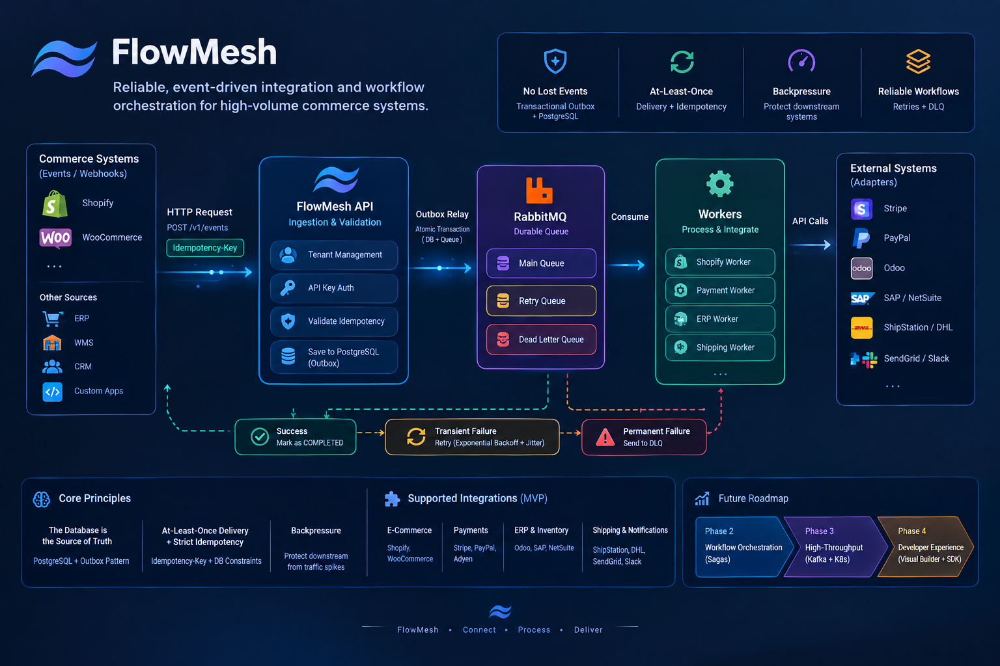
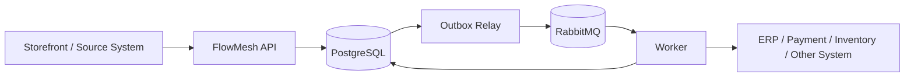

FlowMesh
Reliable integrations and workflow execution for modern commerce systems.
Project status: Early-stage development. The architecture and roadmap below describe the intended product. Features are not considered implemented until they are available and tested in the codebase.

The Problem
Modern commerce businesses rely on several systems to run their operations: e-commerce platforms, payment providers, inventory systems, ERP platforms, warehouses, and shipping services.

When these systems are connected through separate point-to-point integrations, each connection becomes another component that engineering teams must build, maintain, monitor, and troubleshoot. Traffic spikes can overwhelm downstream services, temporary API failures can interrupt order workflows, and repeated webhook deliveries can trigger duplicate processing.

As integrations grow, so does the operational burden. Engineers spend time investigating failed jobs and maintaining custom retry logic, while operations teams may need to review and repair transactions manually. These problems consume engineering capacity, slow down business processes, and can put orders and revenue at risk.
The Solution
FlowMesh is a centralized integration and workflow execution layer designed to make communication between business systems more reliable.

Instead of requiring every application to implement its own delivery, retry, and failure-handling logic, FlowMesh is designed to accept business events, persist them, and process them asynchronously through controlled workers.

Its reliability model is built around durable persistence, idempotent processing, a transactional outbox, message queues, retry policies, and failure handling. The goal is to give engineering teams one place to manage the execution of integrations rather than maintaining a collection of disconnected, one-off pipelines.
## Architecture Overview

Explore the technical details: [Read the Event Ingestion & Processing Flow](docs/architecture/event-ingestion-flow.md)

Business Value
FlowMesh aims to help businesses:
- Reduce integration maintenance: Reuse a common execution layer instead of repeatedly building delivery and retry logic for every connection.
- Reduce operational overhead: Make failures visible and recoverable, reducing the amount of manual investigation and repair.
- Protect business operations: Use idempotency and controlled retries to reduce duplicate business operations and improve recovery from transient failures.
- Handle traffic spikes more safely: Buffer incoming work and control worker concurrency so downstream systems are not overwhelmed.
- Free engineering capacity: Let teams focus more on business features and less on maintaining integration infrastructure.
The goal is simple: less time managing integrations, fewer operational failures, and more reliable business workflows.
How FlowMesh Works
At a high level, FlowMesh separates event intake from downstream execution:

1. Ingest: A source system sends an event to the FlowMesh API.
2. Validate and deduplicate: FlowMesh authenticates the tenant, validates the request, and applies an idempotency key.
3. Persist: The event, its job record, the idempotency record, and an outbox record are written in one PostgreSQL transaction.
4. Publish: A background relay publishes the outbox record to RabbitMQ after the database transaction commits.
5. Execute: A worker consumes the message and invokes the appropriate connector or handler.
6. Track and recover: FlowMesh records the job outcome. Transient failures can be retried; jobs that cannot be completed within the configured policy can be moved to a dead-letter state for inspection and controlled replay.
For the step-by-step technical design—including duplicate delivery, transaction boundaries, worker behavior, retries, and failure scenarios—see [Event Ingestion & Processing Flow](docs/architecture/event-ingestion-flow.md).
Core Engineering Principles
1. PostgreSQL is the durable source of truth
PostgreSQL stores the event and job state. RabbitMQ transports work to workers; it is not the only record that an event was accepted. The transactional outbox pattern is intended to keep the database state and the intent to publish a message consistent.
2. At-least-once delivery with idempotent handling
Messages may be delivered more than once. FlowMesh is designed around at-least-once processing and idempotent consumers, not an exactly-once delivery claim. Database constraints protect idempotency-key uniqueness, while downstream operations should use provider-supported idempotency keys where available.
3. Asynchronous execution and backpressure
The API should acknowledge an event after it has been durably accepted, without waiting for every downstream system to finish its work. Workers can then process jobs at a controlled concurrency, helping protect slower or rate-limited systems.
4. Explicit failure handling
Transient failures (for example, network timeouts, HTTP 429, or selected 5xx responses) should follow a retry policy with exponential backoff and jitter. Permanent failures and exhausted retries should become inspectable dead-letter jobs rather than disappearing from view.
5. Tenant-scoped data access
The intended initial model is shared-schema multi-tenancy. Every tenant-owned record and query must be scoped by tenant_id; authorization and database constraints should reinforce that isolation.
6. Observability is part of reliability
The system should make job state, attempts, queue depth, processing latency, and connector errors observable. A job should be diagnosable without relying on guesswork or manually searching unrelated services.
MVP Scope
The first milestone focuses on proving the reliable event-to-job execution path. It deliberately avoids building a large connector catalog or a visual workflow builder before the core processing model is dependable.
Capability	Intended MVP behavior
Tenant management	Create tenants and scope their data and credentials
API authentication	Authenticate requests using tenant-scoped API keys
Event ingestion	Accept normalized events through POST /v1/events
Idempotency	Detect repeated submissions using a tenant-scoped idempotency key
Durable persistence	Store events, jobs, idempotency records, and outbox records in PostgreSQL
Outbox relay	Publish committed outbox records to RabbitMQ
Worker execution	Consume jobs and invoke a handler or connector
Retry policy	Retry eligible transient failures using backoff and jitter
Dead-letter handling	Keep permanently failed or exhausted jobs available for inspection
Replay	Allow an authorized operator or API client to request a controlled replay
Basic observability	Expose job states, attempts, errors, and basic processing metrics

Current Development Status
The project is in an early implementation stage. Based on the current development work, the foundation includes a NestJS/TypeScript application, PostgreSQL with TypeORM, a Docker Compose development environment for PostgreSQL and RabbitMQ, and an initial event persistence model.

The complete ingestion-to-worker pipeline is still being developed. The capabilities in the MVP table above should therefore be read as the target scope, not as a claim that every feature is already implemented or production-ready.
Area	Current status
NestJS / TypeScript project foundation	Started
PostgreSQL and TypeORM setup	Started
Docker Compose infrastructure for PostgreSQL and RabbitMQ	Available for local development
Initial event persistence model	Started
Tenant and API-key lifecycle	Planned
Idempotent event ingestion	Planned
Transactional outbox and relay	Planned
RabbitMQ worker execution	Planned
Retry policies and dead-letter handling	Planned
Replay and operational visibility	Planned
Production connectors and dashboard	Planned

Update this table whenever implementation status changes. A feature should only move out of “Planned” when it exists in the codebase and has appropriate tests.

Target Event and Job Lifecycle
The initial job lifecycle is intended to use the following states:
QUEUED
  └──> PROCESSING
         ├──> COMPLETED
         ├──> RETRYING ──> PROCESSING
         └──> DEAD_LETTER
- QUEUED: Persisted and waiting for execution.
- PROCESSING: Claimed by a worker and currently executing.
- COMPLETED: The configured operation completed successfully.
- RETRYING: A retryable failure occurred and another attempt is scheduled.
- DEAD_LETTER: The job failed permanently or exhausted its retry policy and requires inspection or an explicit replay decision.
Additional states such as CANCELLED, PAUSED, or compensation-related states may be introduced if later workflow requirements justify them.
Integration Ecosystem
FlowMesh is intended to use an adapter pattern so the core event-processing system is not tightly coupled to a particular vendor. The following are candidate integrations, not a claim that these connectors are currently available.
Event sources
- Shopify: Order and customer webhooks.
- WooCommerce: Store and order events.
- Custom applications: Events submitted through the FlowMesh API.
Payment providers
- Stripe
- PayPal
- Adyen
Payment operations require special care: FlowMesh-level idempotency helps prevent duplicate job handling, but the connector must also use the payment provider's idempotency mechanism where supported. A message queue alone cannot guarantee that an external payment side effect happens exactly once.
ERP and inventory systems
- Odoo: A candidate for an early integration and development testing.
- SAP and NetSuite: Potential enterprise integrations for later stages.
Shipping and notifications
- Shipping and fulfillment: ShipStation, DHL, and other providers based on customer requirements.
- Notifications: SendGrid, Slack, and other notification services.
The initial release should focus on one or two real integration paths and prove that they work reliably before expanding the connector catalog.