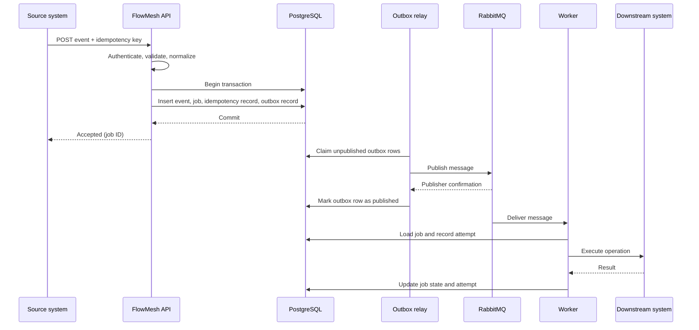

# Event Ingestion and Processing Flow

> **Status:** Target architecture for the early FlowMesh implementation. This document describes the intended processing path; it should not be read as confirmation that every step is already implemented.

## Overview

The ingestion path separates fast, durable event acceptance from slower downstream work. The API should acknowledge a request only after the database transaction has committed. A background relay then publishes the outbox record to RabbitMQ, and a worker performs the downstream operation.



## 1. Receive and validate the request

For a generic integration, a client can submit a normalized event through the planned `POST /v1/events` endpoint.

For a provider-specific webhook such as Shopify, a dedicated adapter should:

1. Read the raw request body and verify the provider's webhook signature using the configured secret.
2. Reject invalid signatures before creating an event.
3. Extract the provider's delivery identifier, such as Shopify's webhook ID, where available.
4. Normalize the provider payload into FlowMesh's internal event shape.
5. Pass the normalized event to the same ingestion use case used by the generic API.

Provider-specific verification and normalization should remain outside the core persistence use case.

## 2. Persist the event and job atomically

The ingestion use case should write the related records in one PostgreSQL transaction. The logical sequence is:

```sql
BEGIN;

-- 1. Reserve the tenant-scoped idempotency key.
-- 2. Insert the accepted event.
-- 3. Insert a job with status QUEUED.
-- 4. Insert an outbox record for the job-created message.

COMMIT;
```

The transaction is important. If any required insert fails, all writes should roll back. The event must not be committed without the corresponding job and outbox record.

The exact table and column names are subject to the implemented schema. The intended logical records are:

- `idempotency_keys`: tenant, key, operation/scope, and the original job reference or response.
- `events`: received event type, source, version, payload, and timestamps.
- `jobs`: execution state and scheduling information.
- `outbox_events`: the message that must eventually be published to the broker.

### Concurrent duplicate requests

A preliminary `SELECT` is not sufficient to prevent two concurrent requests from inserting the same idempotency key. The database must enforce uniqueness, for example with a constraint scoped to the tenant and operation:

```sql
UNIQUE (tenant_id, idempotency_key, operation)
```

The application should handle the unique-constraint conflict and return the original job/result for a repeated request, rather than creating another job. The exact conflict-handling strategy must be tested under concurrent requests.

## 3. Acknowledge after commit

The API should return an acceptance response only after the database transaction commits successfully. It should not wait for RabbitMQ publication or for the downstream integration to finish.

For a webhook source, a fast acknowledgement helps avoid unnecessary provider retries. The response status and body should follow the source provider's requirements and the final FlowMesh API contract.

## 4. Publish through the outbox relay

A separate relay process should repeatedly claim unpublished outbox rows. A PostgreSQL pattern such as `FOR UPDATE SKIP LOCKED` can allow multiple relay instances to claim separate rows without processing the same row simultaneously.

The intended sequence is:

1. Claim eligible unpublished rows in a short database transaction.
2. Publish each message to RabbitMQ using durable queue/message configuration as appropriate.
3. Wait for publisher confirmation.
4. Mark the outbox row as published only after confirmation.

There is an unavoidable duplicate-publication window: the relay may publish successfully and then crash before it records the row as published. On restart, it may publish the same message again. This is why consumers must be idempotent.

## 5. Process the message in a worker

A worker should:

1. Receive the job identifier from RabbitMQ.
2. Load the job from PostgreSQL.
3. Check whether the job is already completed or otherwise no longer eligible for execution.
4. Claim the job safely so that competing workers cannot execute the same job concurrently.
5. Record a job attempt and set the state to `PROCESSING`.
6. Invoke the appropriate connector or handler.
7. Persist the result and the new job state.
8. Acknowledge the broker message only after the worker has safely recorded the outcome or scheduled the next attempt.

The exact transaction and acknowledgement ordering must be designed carefully. Worker crashes can also result in redelivery, so job claiming and state transitions need concurrency protection.

## 6. Handle downstream side effects safely

FlowMesh can prevent duplicate internal job creation and make message handling idempotent. It cannot independently guarantee that an external side effect happens exactly once.

Where a downstream provider supports idempotency keys, the connector should pass a stable key derived from the FlowMesh job or operation. For systems without downstream idempotency support, the connector may need reconciliation or a provider-specific lookup strategy to reduce the risk of repeating an operation after an uncertain timeout.

This is especially important for payment capture, inventory reservation, and order fulfillment.

## 7. Retry and dead-letter behavior

Failures should be classified before deciding what happens next.

| Failure type | Intended behavior |
|---|---|
| Temporary network error or timeout | Retry according to policy |
| HTTP 429 or retryable 5xx | Respect provider guidance where available, then retry with backoff |
| Invalid payload or unsupported operation | Mark as a permanent failure or move to dead-letter handling |
| Retry limit exhausted | Mark the job `DEAD_LETTER` for inspection |

The retry policy should use exponential backoff with jitter and a configurable maximum attempt count. Retry scheduling must not create a hot loop that continuously hammers an unavailable downstream service.

A replay should be an explicit, authorized operation. It should retain the original job/attempt history or create a clearly linked execution record so that operators can understand what happened.

## 8. Suggested module boundaries

A possible NestJS module layout is:

```text
src/
└── events/
    ├── events.module.ts
    ├── events.controller.ts
    ├── webhooks.controller.ts
    ├── use-cases/
    │   └── ingest-event.use-case.ts
    ├── entities/
    │   ├── event.entity.ts
    │   ├── job.entity.ts
    │   ├── idempotency-key.entity.ts
    │   └── outbox-event.entity.ts
    └── normalizers/
        └── shopify.normalizer.ts
```

This is a suggested organization, not a statement about the current repository structure. The actual boundaries can change as the application grows.

## 9. First reliability tests

Before adding multiple external connectors, test the core path with controlled failure scenarios:

- Send many concurrent requests with the same tenant and idempotency key; verify that only one logical job is created.
- Send the same event more than once; verify that the repeated request resolves to the original job.
- Stop RabbitMQ after the database commit; verify that the outbox relay publishes the pending message after RabbitMQ returns.
- Simulate a relay crash after publish but before marking the outbox row; verify that duplicate publication does not duplicate the business operation.
- Stop a worker during processing; verify safe redelivery and state recovery.
- Simulate timeouts, HTTP 429, and retryable 5xx responses; verify retry scheduling and the maximum attempt policy.
- Simulate a permanent error; verify that the job becomes inspectable in the dead-letter state.
- Test replay and verify that it is authorized, observable, and safe for the downstream operation.

The first meaningful milestone is not a large number of connectors. It is a reliable, tested path:

```text
Event
  -> Durable database transaction
  -> Outbox relay
  -> RabbitMQ
  -> Idempotent worker
  -> Downstream operation
  -> Retry or dead-letter handling
  -> Observable final state
```
